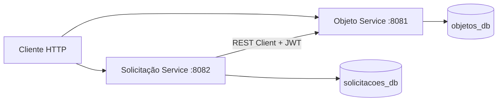

# Achados e Perdidos — PW2

Projeto de Guilherme Fuhr para Programação para Web II (PW2), IFRS — Instituto Federal do Rio Grande do Sul. Backend Java 17 + Quarkus com **dois microsserviços** independentes. A proposta aprovada define exatamente dez endpoints: cinco de objetos e cinco de solicitações de devolução.

## Arquitetura



Cada serviço tem sua própria entidade Panache e seu próprio banco MySQL. O serviço de solicitações guarda apenas `objetoId`; consulta o objeto via REST antes de abrir uma solicitação. Na aprovação, chama `PUT /objetos/{id}/status` para marcar `DEVOLVIDO`; só depois grava `APROVADA`. Se a comunicação falhar, mantém `PENDENTE`. O identificador da solicitação na atualização remota permite repetir uma chamada cuja resposta tenha se perdido.

## Requisitos

- JDK 17 e Maven 3.9+ (ou Maven Wrapper incluído).
- MySQL 8.x, local ou iniciado pelo Docker Compose (imagem 8.4).
- Portas 8081 e 8082 livres; Docker Compose usa a porta local 3307 para MySQL.

## No PC da faculdade

Abra o PowerShell e baixe o projeto:

```powershell
git clone https://github.com/GFuhrS/achados-e-perdidos-pw2.git
cd achados-e-perdidos-pw2
java -version
```

O Java precisa ser **17 ou superior**. O Maven Wrapper baixa o Maven automaticamente na primeira execução, então o PC precisa de internet nesse momento. Para rodar os dois serviços com persistência MySQL, também precisa de Docker ou de acesso a um servidor MySQL. Se o laboratório não permitir Docker nem oferecer MySQL, peça ao professor os dados de conexão antes da demonstração.

## Iniciar

No PowerShell, a partir da pasta deste README:

```powershell
# Execute uma vez. As chaves locais ficam em secrets/ e não entram no Git.
java scripts/TokenTool.java init

# Opção 1: MySQL com Docker
docker compose up -d mysql
```

Para MySQL instalado localmente, execute [mysql-init/01-bancos.sql](mysql-init/01-bancos.sql) como administrador. Configure `OBJETOS_DB_URL`, `SOLICITACOES_DB_URL`, `OBJETOS_DB_USER`, `OBJETOS_DB_PASSWORD`, `SOLICITACOES_DB_USER` e `SOLICITACOES_DB_PASSWORD` conforme o seu ambiente. Os valores padrão apontam para `localhost:3307`, usuários `objetos` e `solicitacoes`, com senhas apenas de desenvolvimento indicadas no SQL. O volume Docker preserva os dados; o SQL de inicialização só roda quando o volume é criado pela primeira vez.

Nesta máquina foi baixado um JDK 17 temporário em `.tools/jdk/` para validar o projeto. Se `java` não estiver no `PATH`, configure `JAVA_HOME` para a pasta `jdk-17...` dentro desse diretório e acrescente `$env:JAVA_HOME\bin` ao `PATH` do terminal. A pasta `.tools/` é ignorada pelo Git.

Abra dois terminais na raiz do projeto:

```powershell
# Terminal 1
cd objeto-service
..\mvnw.cmd quarkus:dev

# Terminal 2
cd solicitacao-service
..\mvnw.cmd quarkus:dev
```

Se tiver Maven instalado, `mvn quarkus:dev` também funciona. Para empacotar os dois: `./mvnw.cmd package` na raiz.
Ao executar um JAR empacotado, inicie-o dentro da pasta do respectivo serviço ou defina `JWT_PUBLIC_KEY` com o caminho absoluto de `secrets/publicKey.pem`.

## JWT de demonstração

Gere tokens na **raiz** do projeto:

```powershell
$admin = java scripts/TokenTool.java token Admin
$user = java scripts/TokenTool.java token User
```

Os tokens RS256 valem por oito horas. Não há serviço de login: o utilitário é apenas para a demonstração da autenticação e autorização exigidas pela disciplina. `User` consulta objetos e cria/consulta solicitações; `Admin` administra objetos e analisa solicitações. O REST Client repassa o cabeçalho `Authorization` recebido. As chaves privadas locais nunca devem ser publicadas.

## Endpoints planejados e implementados

| Serviço | Método e caminho | Papel | Função |
| --- | --- | --- | --- |
| Objetos | `POST /objetos` | Admin | Cadastrar objeto disponível |
| Objetos | `GET /objetos?status=&categoria=&titulo=` | User, Admin | Listar e filtrar |
| Objetos | `GET /objetos/{id}` | User, Admin | Consultar por ID |
| Objetos | `PUT /objetos/{id}` | Admin | Alterar dados do objeto |
| Objetos | `PUT /objetos/{id}/status` | Admin | Marcar devolvido ou descartado |
| Solicitações | `POST /solicitacoes` | User, Admin | Abrir para objeto disponível |
| Solicitações | `GET /solicitacoes/{id}` | User, Admin | Consultar por ID |
| Solicitações | `GET /solicitacoes?status=&objetoId=&email=` | Admin | Listar e filtrar |
| Solicitações | `PUT /solicitacoes/{id}/aprovar` | Admin | Aprovar e devolver objeto |
| Solicitações | `PUT /solicitacoes/{id}/rejeitar` | Admin | Rejeitar solicitação |

Categorias: `DOCUMENTO`, `ELETRONICO`, `VESTUARIO`, `ACESSORIO`, `OUTRO`. Status do objeto: `DISPONIVEL`, `DEVOLVIDO`, `DESCARTADO`. Status da solicitação: `PENDENTE`, `APROVADA`, `REJEITADA`. Um objeto já devolvido ou descartado não retorna a disponível. Uma solicitação analisada não pode ser analisada outra vez.

## Exemplo rápido no PowerShell

```powershell
$admin = java scripts/TokenTool.java token Admin
$user = java scripts/TokenTool.java token User
$objeto = Invoke-RestMethod 'http://localhost:8081/objetos' -Method Post `
  -Headers @{Authorization="Bearer $admin"} -ContentType 'application/json' `
  -Body '{"titulo":"Chave preta","descricao":"Com fita verde","categoria":"ACESSORIO","localEncontrado":"Biblioteca","dataEncontrado":"2024-05-10"}'

$solicitacao = Invoke-RestMethod 'http://localhost:8082/solicitacoes' -Method Post `
  -Headers @{Authorization="Bearer $user"} -ContentType 'application/json' `
  -Body "{`"objetoId`":$($objeto.id),`"nomeSolicitante`":`"Ana Silva`",`"emailSolicitante`":`"ana@example.com`",`"comprovacao`":`"A chave tem uma fita verde`"}"

Invoke-RestMethod "http://localhost:8082/solicitacoes/$($solicitacao.id)/aprovar" `
  -Method Put -Headers @{Authorization="Bearer $admin"}
Invoke-RestMethod "http://localhost:8081/objetos/$($objeto.id)" `
  -Headers @{Authorization="Bearer $user"}
```

O último resultado deve mostrar `DEVOLVIDO`. Para demonstrar a tolerância a falhas, abra outra solicitação, pare o Objeto Service e tente aprová-la: a resposta deve ser HTTP 503 e o status da solicitação deve continuar `PENDENTE`.

## Erros, observabilidade e testes

Dados inválidos retornam HTTP 400; recurso ausente, 404; transição de status inválida, 409; papel insuficiente, 403; sem JWT, 401. Timeout de 2 s, duas tentativas adicionais e fallback protegem a comunicação remota; falha remota não gera aprovação. Há logs das operações, contadores Micrometer (`objetos_cadastrados`, `solicitacoes_criadas`, `solicitacoes_aprovadas`), `/q/health` e `/q/metrics` em cada porta. O health check de prontidão considera o banco de cada serviço.

```powershell
# Testes automatizados, com H2 somente no perfil de testes; produção usa MySQL.
.\mvnw.cmd test
```

Os testes cobrem endpoints, papéis, validação, transições e falha remota. O roteiro acima verifica a comunicação HTTP real entre os processos. O teste de integração completo com MySQL exige o banco em execução.

Validação local: `mvnw.cmd verify` passou com **11 testes** e gerou os dois JARs. Também foram iniciados os dois serviços com bancos H2 separados no perfil `test`: tokens JWT reais atravessaram o REST Client, a aprovação devolveu o objeto e, com o Objeto Service parado, a aprovação retornou `503` sem tirar a solicitação de `PENDENTE`. O MySQL não estava instalado nesta máquina e não foi testado aqui.

## Referências

- [Enunciado da disciplina PW2](https://pw2.rpmhub.dev/topicos/projeto/enunciado.html).
- [Rubrica de avaliação (10 pontos)](https://pw2.rpmhub.dev/topicos/projeto/rubrica.html) e proposta `proposta_achados_e_perdidos (1).pdf` fornecida pelo aluno.
- [Quarkus: REST Client](https://quarkus.io/guides/rest-client), [Panache](https://quarkus.io/guides/hibernate-orm-panache), [JWT](https://quarkus.io/guides/security-jwt), [Fault Tolerance](https://quarkus.io/guides/smallrye-fault-tolerance), [Health](https://quarkus.io/guides/smallrye-health), [Micrometer](https://quarkus.io/guides/telemetry-micrometer).
- ZIPs de referência enviados pelo aluno: `BookStore.zip`, `BookStorePW2 (1).zip` e `CheckoutPayment.zip`. Foram consultados para conhecer a organização do projeto e os conceitos usados na disciplina. Este código foi escrito para o domínio de achados e perdidos, sem seguir um tutorial específico ou copiar um microsserviço dessas referências.

## Conferência pela rubrica

1. **Arquitetura (3 pontos):** dois serviços, bancos próprios, responsabilidades separadas, REST Client funcional e fluxo alinhado ao diagrama.
2. **Funcionalidades (4 pontos):** dez endpoints da proposta, regras de negócio e códigos de erro.
3. **Requisitos não funcionais (3 pontos):** JWT por papéis, timeout/retry/fallback, logs, métricas e health checks.
